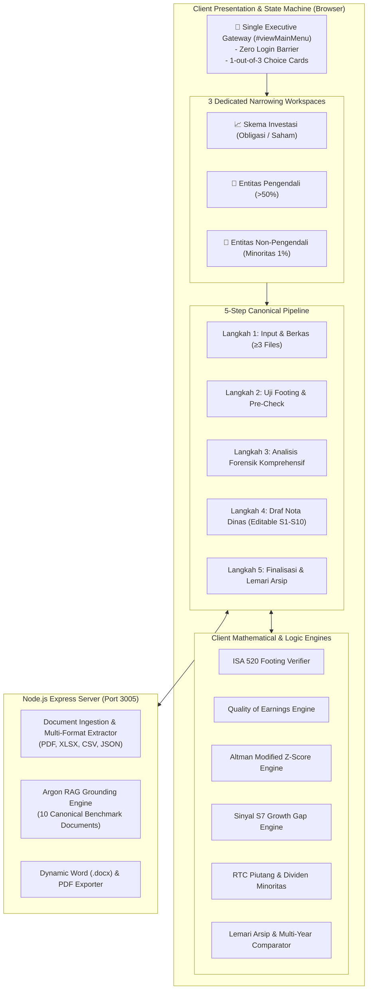

# 🏛️ Kajian Ihsan Financial Intelligence: Architecture Specification

## 1. System Topology & Architectural Philosophy

Kajian Ihsan Financial Intelligence is an enterprise-grade financial forensic analysis platform tailored for executive decision-makers, senior board members, and forensic auditors.

The platform follows a **Deterministic Computation & Zero-Hallucination** architectural principle:
- **No Fictional Extrapolations:** Financial metrics (Z-Score, Quality of Earnings, NWC, S7 Gap, RTC Piutang, Minorities) are calculated using pure deterministic mathematical engines in JavaScript.
- **Air-Gapped Reliability:** The application runs fully locally or on private clouds without mandatory external API dependencies. LLM inference (Google Gemini / OpenAI) is applied purely as an optional analytical copilot grounded strictly by internal document references.
- **Single-Door Narrowing Workflow:** Prevents executive cognitive overload by funneling users through a single question (*"Hi Ihsan, Mau Analisa Apa Hari Ini?"*) into one of three isolated analytical channels.

---

## 2. Component Hierarchy & Navigation Lifecycle

### 2.1 Single Entry Gateway (`#viewMainMenu`)
- **Container:** `#omIhsanExecutiveGateway`
- **Greeting:** `👋 Hi Ihsan, Mau Analisa Apa Hari Ini?`
- **Zero Login Guarantee:** The root application loads directly into an interactive executive dashboard.
- **Navigation Invariant:** On Page 1, all redundant navigation bars (`.entity-nav-strip`) are permanently hidden (`display: none !important`) to eliminate visual clutter.

### 2.2 Narrowing Navigation Transition (`enterSchemePortal`)
When an executive selects one of the 3 portals:
1. All other views are hidden (`display: none`).
2. Target workspace is displayed (`display: block`).
3. Window scroll position is smoothly reset to top (`window.scrollTo({ top: 0, behavior: 'smooth' })`).
4. A high-contrast locked context banner is presented at the top:
   - `[← Ganti Pilihan Analisis / Kembali ke Beranda Om Ihsan]`
   - Badge indicating the active analytical domain (e.g. `FOKUS TERKUNCI: SKEMA INVESTASI`).

---

## 3. Data Processing & Analytical Engines

### 3.1 Multi-File Absorption Engine (`ingestLedger`)
Capable of accepting 3 or more documents simultaneously per analysis session:
- **Balance Sheet (Neraca):** Extracts Assets, Liabilities, Working Capital.
- **Income Statement & CALK:** Extracts Revenue, COGS, Opex, Associate Income, FX gains, Interest Expenses.
- **Corporate Action / Governance Records:** Extracts RKAP targets, RUPS resolutions, Bond/Sukuk covenants.

### 3.2 Canonical Audit & Math Formulations

| Domain | Formula / Standard | Verification Threshold |
| :--- | :--- | :--- |
| **ISA 520 Audit** | $\Delta = |\text{Total Aset} - (\text{Liabilitas} + \text{Ekuitas})|$ | $\Delta = 0,00$ |
| **Altman Z'' Score** | $Z'' = 6,56 X_1 + 3,26 X_2 + 6,72 X_3 + 1,05 X_4$ | Safe if $>2,60$; Grey if $1,10 - 2,60$ |
| **Quality of Earnings** | $\text{Non-Op Ratio} = \frac{\text{Asosiasi} + \text{Kurs} + \text{Lainnya}}{\text{Laba Bersih}}$ | High Risk if Non-Op $> 50\%$ |
| **S7 Growth Gap** | $\text{Gap} = \Delta\%\text{ Opex} - \Delta\%\text{ Revenue}$ | Warning if Gap $> 0\%$ |
| **RTC Piutang** | $\text{RTC} = \frac{\text{Piutang Usaha Aktual}}{\text{Pagu Target RKAP}} \times 100\%$ | Red Flag if $\text{RTC} > 150\%$ |
| **Hak Dividen 1%** | $\text{Dividen} = 1,00\% \times \text{Laba Bersih}$ | Cross-checked with unpaid dividend debt |

---

## 4. Lemari Arsip ("Nice Category Shelf") Architecture

The Step 5 storage engine ensures finalized reports are safely archived without relying on volatile local storage:
1. **Interactive Finalization Modal (`#modalFinalizeLoading`):**
   - Renders 3 sequential verification checkmarks with micro-animations.
   - Saves parsed metadata, canonical line items, and generated Nota Dinas into the Knowledge Base ledger.
2. **Category Tabs:**
   - `Lemari Investasi`: Stores reports for Pindo Deli, DAAZ, and investment bond issuers.
   - `Lemari Pengendali`: Stores reports for PT EPS and operational subsidiaries (>50%).
   - `Lemari Non-Pengendali`: Stores reports for PT POJ and minority interest holdings.
   - `Konsolidasi`: Stores group-wide roll-ups.
3. **Side-by-Side Multi-Year Comparator (`quickCompareWithPreviousYear`):**
   - Automatically pairs the active report with historical records from the same entity.
   - Computes nominal and percentage variances ($\Delta$ and $\Delta\%$) across every financial statement line item.

---

## 5. Security, Privacy & Determinism Guardrails

- **Zero Data Leakage:** Financial PDFs and Excel models are parsed locally within the server sandbox or browser memory; no data is ever transmitted to third parties unless an explicit cloud AI API key is configured.
- **Immutable Financial Logic:** The calculation models are isolated in pure functions with zero side-effects, guaranteeing that identical inputs always yield identical outputs.
- **Verification Guarantee:** 10 automated test suites with 231 assertions ensure all user flows, mathematical equations, and UI boundaries remain defect-free across all updates.
