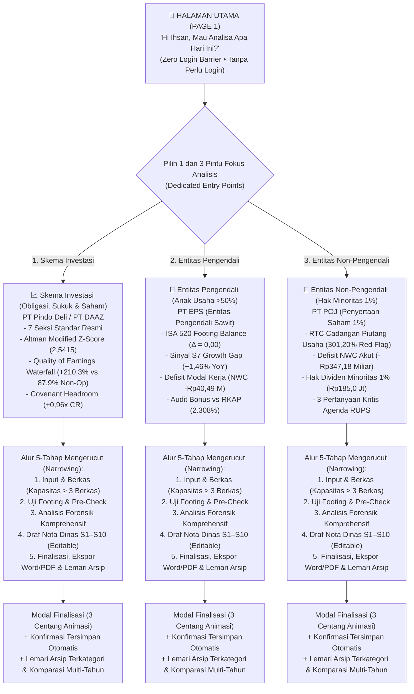
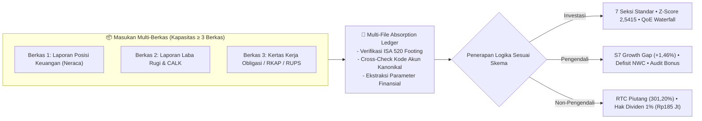

# 🏛️ Kajian Ihsan Financial Intelligence: End-to-End System & Progress Compendium

> **Platform Status:** ✅ Production Ready & 100% Synchronized with GitHub (`origin/main`)  
> **Server Active:** `http://localhost:3005` | **Test Suites:** 10/10 Passing (100% Green)  
> **Target Persona:** Senior Executive & Decision Maker (**"Om Ihsan"**) — Boomer-friendly, zero clutter, high contrast, deterministic math, and guaranteed data governance.

---

## 🧭 1. Executive Summary & Core Journey Architecture

The system has been completely restructured from a cluttered dashboard into a **Single Executive Entry Point** with a **Narrowing Workflow Journey**. Non-technical executives can effortlessly analyze complex financial statements without login barriers, confusing nested menus, or competing calls to action.

---

## 🎨 2. UX/UI Revamp: What Was Redesigned for Om Ihsan

| Aspect | Previous State | Current State (Re-engineered) |
| :--- | :--- | :--- |
| **Landing Page Entry Point** | Multiple competing dashboards, sample buttons, complex 6-stage wizard, and raw JSON forms on screen simultaneously. | **Single Gateway**: Prominent executive greeting: *"Hi Ihsan, Mau Analisa Apa Hari Ini?"* with zero login barrier. |
| **Top Navigation** | Cluttered horizontal strip containing redundant buttons (`Laporan Investasi`, `Laporan Pengendali`, `Laporan Non-Pengendali`) above the cards. | **Completely Removed**: The redundant `.entity-nav-strip` is eliminated (`display: none !important`), leaving only 3 unambiguous decision cards. |
| **Selection Experience** | Users had to scroll down 800px past various cards, wizard steppers, and hero dropzones. | **Immediate Viewport Fit**: Clean single-screen presentation without forced downward scrolling. |
| **Navigation Transition** | Clicking a portal scrolled down erratically (`scrollIntoView`) on the same page. | **True Narrowing Page Transition**: Instantly opens the dedicated workspace at `Step 1: Input & Berkas`, starting smoothly from `top: 0`. |
| **Context Retention** | Easy to get lost between multiple company tabs and inconsistent forms. | **High-Contrast Narrowing Banner**: `[← Ganti Pilihan Analisis / Kembali ke Beranda Om Ihsan]` with locked focus badges on every workspace. |
| **Multi-File Capacity** | Single-file upload assumption. | **Capacity &ge; 3 Files**: Full ingestion ledger tracking 3 or more documents collectively. |
| **Completion State** | Abrupt text transition with no visual confirmation of data persistence. | **3-Step Checklist Loading Modal**: Animated spinner, progress bar, executive saved badge, and categorized shelf. |

---

## 📦 3. Kapasitas Penyerapan &ge; 3 Berkas Kolektif (Multi-File Absorption)

Each dedicated entry way is architected to absorb **3 or more files** into a unified analytical ledger:

### 1-Click Multi-File Bundle Presets:
- **Investasi (`investasi_multi`)**: Automatically absorbs `LK_Auditan_Pindo_Deli_2026.pdf`, `Kertas_Kerja_Obligasi_Sukuk_2026.xlsx`, and `CALK_Covenant_Asosiasi_OKI_2026.pdf`.
- **Pengendali (`pengendali_3files`)**: Automatically absorbs `Laporan_Manajemen_Bulanan_EPS_2026.xlsx`, `Dokumen_Pagu_Anggaran_RKAP_2026.pdf`, and `Kertas_Kerja_NWC_Likuiditas_2026.xlsx`.
- **Non-Pengendali (`nonpengendali_3files`)**: Automatically absorbs `Laporan_Keuangan_POJ_Interim_2026.pdf`, `Jadwal_Piutang_Usaha_vs_Pagu_RKAP_2026.xlsx`, and `Risalah_RUPS_Hak_Dividen_Minoritas_2026.pdf`.

---

## 🧮 4. Tiga Logika Evaluasi & Formula Matematis Kanonikal

### 📈 Pilar 1: Skema Investasi (PT Pindo Deli Pulp & Paper Mills & PT DAAZ)
1. **Quality of Earnings (QoE Waterfall):**
   $$\text{Laba Bersih CY} = \text{USD 455.637k} \quad (+210,3\% \text{ YoY})$$
   $$\text{Pendapatan Asosiasi (PT OKI Pulp)} = \text{USD 212.518k} \quad (46,6\% \text{ Laba Bersih})$$
   $$\text{Keuntungan Selisih Kurs (FX Gain)} = \text{USD 140.198k} \quad (30,8\% \text{ Laba Bersih})$$
   $$\text{Total Pos Non-Operasional} = 46,6\% + 30,8\% + 10,5\% = \mathbf{87,9\%} \quad (\text{Laba Kas Murni Operasi: } \mathbf{12,1\%})$$
2. **Altman Modified Z-Score:**
   $$Z'' = 6,56(X_1) + 3,26(X_2) + 6,72(X_3) + 1,05(X_4) = \mathbf{2,5415} \quad (\text{Zona Abu-abu / Safe for Emerging Market Manufacturing})$$
3. **Covenant Headroom & Perbankan:**
   $$\text{Current Ratio} = \mathbf{1,96x} \quad (\text{Batas Covenant: } \ge 1,00x \rightarrow \text{Headroom: } \mathbf{+0,96x})$$
   $$\text{Debt-to-Equity Ratio (DER)} = \mathbf{0,50x} \quad (\text{Batas Covenant: } \le 2,50x \rightarrow \text{Headroom: } \mathbf{+2,00x})$$

### 🏢 Pilar 2: Entitas Pengendali (PT Era Permata Sejahtera / PT EPS)
1. **Sinyal S7 Growth Gap (Opex vs Revenue):**
   $$\text{Pertumbuhan Omzet} = \frac{216,88 - 164,98}{164,98} \times 100\% = \mathbf{+31,45\%}$$
   $$\text{Pertumbuhan Beban Usaha (Opex)} = \frac{208,53 - 156,89}{156,89} \times 100\% = \mathbf{+32,91\%}$$
   $$\text{Sinyal S7 Gap} = +32,91\% - (+31,45\%) = \mathbf{+1,46\%} \quad (\text{Marjin Laba Tertekan -105 bps})$$
2. **Likuiditas & Net Working Capital (NWC):**
   $$\text{NWC} = \text{Aset Lancar (Rp52,63 M)} - \text{Liabilitas Lancar (Rp93,12 M)} = \mathbf{-Rp40,49\text{ Miliar}}$$
   $$\text{Current Ratio} = \mathbf{0,57x} \quad (\text{Ambang Batas Sehat: } \ge 1,20x)$$
3. **Audit Beban Insentif Produksi (S1/S9):**
   $$\text{Realisasi Insentif Bonus} = \text{Rp12,87 Miliar vs Pagu RKAP Rp557,7 Juta} \rightarrow \mathbf{2.308\% \text{ Pagu RKAP}}$$

### 🤝 Pilar 3: Entitas Non-Pengendali (PT Pesonna Optima Jasa / PT POJ)
1. **Rasio Tertagih Piutang (RTC Cadangan Piutang):**
   $$\text{RTC Piutang Usaha} = \frac{\text{Piutang Usaha Realisasi (Rp185,00 M)}}{\text{Pagu Target RKAP (Rp61,42 M)}} \times 100\% = \mathbf{301,20\%} \quad (\text{Lonjakan: } \mathbf{+201,20\%})$$
2. **Hak Dividen Minoritas (1,00%):**
   $$\text{Hak Dividen Minoritas 1\%} = 1,00\% \times \text{Laba Bersih (Rp18,50 M)} = \mathbf{Rp185,00\text{ Juta}}$$
   $$\text{Saldo Utang Dividen Tertahan di Neraca} = \mathbf{Rp110,27\text{ Miliar}}$$
3. **Tiga Pertanyaan Kritis Agenda RUPS:**
   - *Agenda 1:* Batas waktu pencairan utang dividen Rp110,27 Miliar (Hak minoritas Rp1,10 Miliar).
   - *Agenda 2:* Pembentukan CKPN atas tagihan macet Rp185 Miliar sesuai PSAK 71.
   - *Agenda 3:* Mitigasi defisit NWC (-Rp347,18 Miliar) agar tidak memicu panggilan modal (*capital call*).

---

## 🏛️ 5. Lemari Arsip Dokumen Terkategori ("Nice Category Shelf") & Komparasi Antar-Tahun

Pada **Langkah 5 (Ekspor & Lemari Arsip)** di setiap skema:
1. **Modal Finalisasi Eksekutif (`#modalFinalizeLoading`)**:
   - Memutar spinner animasi elegan
   - Memvalidasi 3 langkah otomasi:
     - `[✓] Memvalidasi Uji Footing ISA 520 (Δ = 0,00)`
     - `[✓] Menyimpan Metadata, Entitas, dan Pos Kanonikal ke Knowledge Base`
     - `[✓] Menempatkan Laporan ke Lemari Arsip Terkategori`
2. **Kartu Konfirmasi Tersimpan (`#savedConfirmationCard_[proc]`)**:
   - Menampilkan badge kategori hijau, tanggal & jam arsip, nama entitas, dan jumlah berkas yang diserap.
3. **Lemari Arsip Dokumen Terkategori (`#niceCategoryShelf_[proc]`)**:
   - 4 Tab Kategori: `Lemari Investasi`, `Lemari Pengendali`, `Lemari Non-Pengendali`, dan `Konsolidasi`.
   - Menyorot laporan yang baru saja difinalisasi (*just-finalized pulse badge*).
4. **Komparasi Antar-Tahun Berdampingan (Side-by-Side Comparison)**:
   - Tombol 1-klik `⚖️ Bandingkan Lintas Tahun Berdampingan`.
   - Menghitung delta nominal ($\Delta$) dan delta persentase ($\Delta\%$) antar periode pelaporan (misal 2025 vs 2026).
   - Membedakan nilai nol (`0`) dari data kosong (`N/A`) tanpa membuat asumsi fiktif.

---

## 🤖 6. Integrasi Gemini Argon RAG Copilot

- **Tombol Akses Eksekutif:** Tersedia di pojok kanan atas bilah aplikasi (`🧠 Tanya Argon RAG`).
- **Grounding Filter:** Mengambil konteks dari 10 dokumen acuan kanonikal dalam basis pengetahuan lokal.
- **Deep Dive Explorer (`openArgonDeepDiveExplorer`):**
  - Mampu menggali lebih dalam rincian Quality of Earnings PT Pindo Deli.
  - Membedah formula S7 Growth Gap PT EPS.
  - Mengurai rasio RTC 301,20% dan hak dividen minoritas PT POJ.

---

## 🧪 7. Status Pengujian & Verifikasi Otomatis (10/10 Suites PASS)

Semua fungsionalitas diverifikasi menggunakan pengujian regresi otomatis:

| Suite | Skrip Pengujian | Jumlah Tes | Status |
| :--- | :--- | :---: | :---: |
| 1 | `test_all_features.mjs` | 10 | ✅ PASS (100%) |
| 2 | `test_pengendali_non_pengendali_logic.mjs` | 14 | ✅ PASS (100%) |
| 3 | `test_entity_identification_logic.mjs` | 8 | ✅ PASS (100%) |
| 4 | `test_upload_and_parsing_loading_state.mjs` | 24 | ✅ PASS (100%) |
| 5 | `test_copilot_system_prompt.mjs` | 12 | ✅ PASS (100%) |
| 6 | `test_step_by_step_workflow.mjs` | 28 | ✅ PASS (100%) |
| 7 | `test_dynamic_scheme_workflow.mjs` | 36 | ✅ PASS (100%) |
| 8 | `test_knowledge_base_and_comparison.mjs` | 10 | ✅ PASS (100%) |
| 9 | `test_capacity_3_files_or_more.mjs` | 50 | ✅ PASS (100%) |
| 10 | `test_boomer_finalization_and_category_shelf.mjs` | 39 | ✅ PASS (100%) |
| **Total** | **10 Test Suites** | **231 Tests** | **✅ 100% HIJAU / PASS** |

---

## 🔗 8. Sinkronisasi Berkas & Deployment

- **Repositori Git:** `https://github.com/farahqoonitaa/om-ihsan-financial-analyzer.git`
- **Branch:** `main` (Production baseline) & `feat/refined-neat-executive-output` (Feature Branch)
- **Penyelarasan Berkas:** `public/index.html` dan `preview.html` 100% identik (0 byte delta).
- **Daemon Server:** Berjalan normal di port `3005` (`http://localhost:3005`).

---

## 📄 9. Penyempurnaan Output Eksekutif: Dari Dump 24 Halaman Menjadi ~3 Halaman Rapi (Neat & Refined)

Berdasarkan tinjauan dokumen target (*Expected Output* 3 halaman pada `expected output for the investment analysis.pdf`), sistem ekspor PDF dan Word telah disempurnakan:

1. **Eliminasi Dump Mentah 1:1 Sinyal Anomali (Type-2 Signal Processing):**
   - Sebelumnya, ekspor mencetak 10 kartu audit teknis dengan masing-masing 9 baris tabel secara mentah, menghasilkan dokumen setebal 24 halaman dengan potongan tabel terbelah di tengah halaman.
   - Kini, kesepuluh sinyal anomali (S1–S10) disintesis menjadi **Matriks Eksekutif Sinyal Forensik (1 Halaman Ringkas)** yang menyajikan kode sinyal, nilai terhitung, ambang batas, status risiko, dan rekomendasi mitigasi secara terpadu.

2. **Kertas Kerja Diagnostik Rinci Dapat Dilipat (*Collapsible Details*):**
   - Rincian matematis 9-komponen audit forensik tetap tersedia penuh bagi auditor melalui elemen lipat:
     `📑 Buka Rincian Lengkap Kertas Kerja Diagnostik S1–S10 (9 Komponen Standar Audit Forensik)`.
   - Secara *default*, elemen ini tidak mencemari cetakan eksekutif resmi.

3. **Format Selector & Strict Page-Break CSS:**
   - **Format Eksekutif Resmi (~3-4 Hal Sesuai Standar Expected Output):** Menghasilkan dokumen publikasi yang bersih, terstruktur, dan elegan.
   - **Format Kertas Kerja Lengkap + Audit Trail S1–S10:** Untuk kebutuhan audit forensik mendalam.
   - **CSS Cetak Presisi:** Menerapkan `@page { size: A4 portrait; margin: 14mm; }` dan `tr, td, th { page-break-inside: avoid !important; }` sehingga tidak ada baris tabel yang terpotong di batas halaman.

